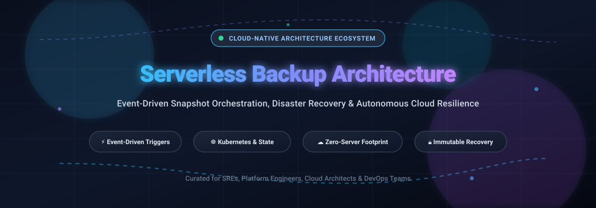

# ⚡ Awesome Cloud-Native Serverless Backup Architecture 🛡️

**🚀 A curated index of production-ready SaaS platforms, enterprise tools, and open-source frameworks for event-driven backup orchestration, cloud-native disaster recovery (DR), and serverless data protection.**

🎯 [Sector Overview](#-sector-overview--market-dynamics) • 🏢 [SaaS Platforms](#-saas-platforms) • 🔓 [Open-Source Solutions](#-open-source-github-projects) • 🏗️ [Architecture Patterns](#-serverless-backup-architectures--patterns) • 📊 [Evaluation Matrix](#-evaluation-matrix--selection-criteria) • 🤝 [Contributing](#-how-to-contribute) • 💖 [Support](#-support)

---

## 📖 Overview

Modern cloud architectures eliminate dedicated backup servers in favor of **event-driven, serverless execution** and **cloud-native storage APIs**. By combining managed compute (AWS Lambda, Azure Functions, Cloudflare Workers) with object storage (S3, GCS, Azure Blob, R2) and declarative workflow engines, engineering teams achieve automated snapshot orchestration, continuous replication, application-consistent point-in-time recovery (PITR), and ransomware-resilient immutable backups with zero idle compute costs. 🔒⚡

---

## 📊 Sector Overview & Market Dynamics

The global Cloud Backup and Disaster Recovery (BDR / DRaaS) market is estimated at **$21 billion to $26 billion in 2026**, expanding at a rapid compound annual growth rate (CAGR) exceeding 20% fueled by enterprise cloud migration and cyber-resilience imperatives. 📈 Structurally, the foundation is **moderately concentrated** among top-tier hyperscalers (Microsoft, AWS, Google Cloud) and incumbent enterprise platforms, while the specialized cloud-native and Kubernetes data protection tier remains **fragmented and competitive**, driving continuous M&A activity and open-source innovation. 🧩

---

## 📑 Table of Contents

- [📊 Sector Overview & Market Dynamics](#-sector-overview--market-dynamics)
- [🏢 SaaS Platforms](#-saas-platforms)
- [🔓 Open-Source GitHub Projects](#-open-source-github-projects)
- [🏗️ Serverless Backup Architectures & Patterns](#-serverless-backup-architectures--patterns)
- [⚖️ Evaluation Matrix & Selection Criteria](#-evaluation-matrix--selection-criteria)
- [🤝 How to Contribute](#-how-to-contribute)
- [💖 Support](#-support)
- [⭐ Star History](#-star-history)
- [📜 License & Disclaimer](#-license--disclaimer)

---

## 🏢 SaaS Platforms

The table below lists leading SaaS platforms and cloud-native serverless runtimes for backup automation, disaster recovery, and event-driven orchestration, ordered descending by company valuation / market capitalization:

| Product | Company Scale (Valuation / Market Cap) | Description | Starting Pricing | Free Tier / Trial Limits |
|:---|:---|:---|:---|:---|
| **[Microsoft Azure Backup](https://azure.microsoft.com/en-us/products/backup/)** | **~$3.1 Trillion** (Market Cap) | ☁️ Native Azure policy-driven backup service protecting VMs, SQL Server, SAP HANA, Azure Files, Blobs, and AKS with Recovery Services and Backup Vaults; triggers Azure Functions for post-backup processing. | **$5.00/instance/month** (for instances ≤ 50 GB) + Azure storage costs ($0.0224/GB-month LRS) | **Free Account**: $200 trial credit valid for 30 days + access to 55+ services free for 12 months |
| **[AWS Backup](https://aws.amazon.com/backup/)** | **~$2.1 Trillion** (Market Cap) | 🛡️ Centralized, policy-based backup service spanning EC2, EBS, RDS, Aurora, DynamoDB, EFS, and Redshift Serverless; supports event-driven triggers via EventBridge and AWS Lambda. | **$0.01/GB-month** (cold storage) / **$0.05/GB-month** (warm storage); restore billed from $0.02/GB | **AWS Free Tier**: Free for first 12 months with limited initial EBS snapshot and DynamoDB backup allowances |
| **[Google Cloud Backup and DR](https://cloud.google.com/backup-disaster-recovery)** | **~$2.1 Trillion** (Market Cap) | 🌐 Centralized management of application-consistent backups across Compute Engine VMs, Google Cloud VMware Engine, and databases in original native format with zero egress overhead. | **$0.026/GB-month** (Standard Backup Storage) + backup management fee ($0.03/GB-month active capacity) | **Free Trial**: $300 credit valid for 90 days across all Google Cloud services |
| **[Cloudflare Workers](https://workers.cloudflare.com/)** | **~$95 Billion** (Market Cap) | ⚡ Edge serverless compute execution environment ideal for executing backup webhooks, verifying HMAC signatures, dispatching notifications, and scheduling zero-egress R2 replication workflows. | **$5.00/month** (Workers Paid plan includes 10M requests/month + $0.30 per additional 1M) | **Free Plan**: 100,000 requests/day, 10ms CPU time per invocation, up to 300 Worker scripts |
| **[Vercel Serverless Functions](https://vercel.com/)** | **~$9.3 Billion** (Valuation, Series F) | 📐 Edge and serverless functions optimized for deploying backup APIs, webhook responders, and scheduled Cron Jobs connected to cloud database persistence targets. | **$20.00/user/month** (Vercel Pro plan includes 1 TB bandwidth, 1,000 GB-hours function compute) | **Hobby Plan (Free forever)**: 100 GB-hours/month compute, 1,000,000 function invocations/month, non-commercial only |
| **[Supabase Edge Functions](https://supabase.com/edge-functions)** | **~$5.0 Billion** (Valuation, Series E) | ⚡ Globally distributed Deno-based TypeScript serverless runtimes for orchestrating automated database dump triggers, Point-in-Time Recovery (PITR), and Supabase Storage synchronization. | **$25.00/month** (Supabase Pro plan includes 2M Edge Function invocations, 8 GB database, 100 GB storage) | **Free Plan (Free forever)**: 500,000 Edge Function invocations/month, 500 MB database, 1 GB storage |
| **[Fastly Compute](https://www.fastly.com/products/edge-compute)** | **~$2.5 Billion** (Market Cap) | 🚀 WebAssembly-powered edge serverless compute for ultra-low-latency event validation, resilient notification routing, and distributed multi-cloud backup triggers. | **$0.50/million requests** + $0.00002/GB-sec execution time (Pay-as-you-go) | **Free Trial**: $50 credit for developer testing across edge compute and services |
| **[Druva](https://www.druva.com/)** | **~$2.0 Billion** (Valuation, Series H) | 🔐 100% SaaS cloud data protection engine built natively on AWS serverless compute; provides immutable backups, global deduplication, and automated air-gapped ransomware defense. | **$210.00/TB/month** (Enterprise Tier starting estimate based on consumed deduplicated storage) | **Free Trial**: Full-featured 30-day evaluation trial with up to 1 TB protected data, no credit card required |
| **[Serverless Framework](https://www.serverless.com/)** | **~$75 Million** (Estimated Valuation) | 📦 Infrastructure-as-code CLI and management console for defining, provisioning, and monitoring multi-cloud serverless backup cron jobs and event handlers. | **$29.00/month** (Developer/Team tier for team collaboration, CI/CD integrations, and policy audits) | **Free Plan (Free forever)**: Open-source CLI engine with unlimited local and single-developer deployments |
| **[Wasmer Edge](https://wasmer.io/)** | **~$40 Million** (Estimated Valuation) | 🧩 High-performance WebAssembly serverless platform enabling lightweight, isolated backup orchestrators and micro-utilities to run across any edge point-of-presence. | **$29.00/month** (Wasmer Pro with dedicated concurrency, custom domains, and production compute) | **Free Plan (Free forever)**: 100,000 requests/month, 10 GB bandwidth, and 1 GB package storage |

---

## 🔓 Open-Source GitHub Projects

Curated open-source backup systems, cloud-native storage synchronizers, Kubernetes operators, and serverless automation tooling, ordered descending by GitHub stargazers count:

| Project | Stars | Language | Focus & Architecture Description |
|:---|:---|:---|:---|
| **[rclone](https://github.com/rclone/rclone)** |  | Go | 🔄 The "rsync for cloud storage". Synchronizes and backs up data across 70+ cloud providers (S3, GCS, Azure Blob, B2, Wasabi, WebDAV) with built-in chunker, encryption, and bandwidth control; easily packaged into Lambda container images or Kubernetes CronJobs. |
| **[Serverless Framework](https://github.com/serverless/serverless)** |  | JavaScript / TypeScript | ⚡ The standard open-source framework for building serverless applications; coordinates event-driven backup pipelines, database snapshot jobs, and multi-region replication scripts across AWS, Azure, and Google Cloud. |
| **[Restic](https://github.com/restic/restic)** |  | Go | 🔐 Secure, deduplicated, and cryptographically verified backup program. Operates directly over object storage backends (AWS S3, MinIO, Azure Blob) without server components; seamlessly invokable via ephemeral serverless container runners. |
| **[Duplicati](https://github.com/duplicati/duplicati)** |  | C# | 💾 Cloud-native client backup software storing encrypted, incremental, and compressed backups on major cloud storage providers with integrated scheduler and web interface. |
| **[Kopia](https://github.com/kopia/kopia)** |  | Go | 🚀 Next-generation backup and restore engine with zero-knowledge encryption, deduplication, and snapshot lifecycle policies. Built to push directly to cloud buckets with repository server capabilities. |
| **[Litestream](https://github.com/benbjohnson/litestream)** |  | Go | 🌊 Streaming replication tool for SQLite databases. Replicates SQLite WAL frames continuously to S3, GCS, and Azure Blob, enabling zero-RPO serverless database architectures. |
| **[BorgBackup](https://github.com/borgbackup/borg)** |  | Python / C | 🗜️ Deduplicating archiver with authenticated encryption; widely deployed with serverless triggers and wrappers (like Borgmatic) for offsite cold-tier replication. |
| **[Velero](https://github.com/vmware-tanzu/velero)** |  | Go | ☸️ The industry standard for Kubernetes disaster recovery, cluster migration, and persistent volume snapshots. Integrates with cloud CSI drivers and object stores. |
| **[OpenEBS](https://github.com/openebs/openebs)** |  | Go / C | 📦 Container Attached Storage (CAS) for Kubernetes providing volume snapshotting, cross-AZ replication, and integrated cloud-native data migration. |
| **[Longhorn](https://github.com/longhorn/longhorn)** |  | Go | 🐮 Cloud-native distributed block storage built for Kubernetes with built-in asynchronous incremental snapshots and secondary backup to S3-compatible targets. |
| **[Backup](https://github.com/backup/backup)** |  | Ruby | 💎 Battle-tested DSL for configuring database and file backups with built-in compression, encryption, and multi-cloud storage sync. |
| **[WAL-G](https://github.com/wal-g/wal-g)** |  | Go | 🐘 Archival and restoration tool for PostgreSQL, MySQL, and Redis. Streams write-ahead logs directly to cloud object storage with atomic push/pull routines. |
| **[WAL-E](https://github.com/wal-e/wal-e)** |  | Python | 🐍 Continuous archiving software for PostgreSQL database clusters using AWS S3, Google Cloud Storage, or Azure Blob Storage. |
| **[Stash](https://github.com/stashed/stash)** |  | Go | 🛡️ Cloud-native data backup and recovery operator for Kubernetes. Backs up stateful applications, databases, and PVCs to encrypted cloud object storage repositories. |
| **[K8up](https://github.com/k8up-io/k8up)** |  | Go | ⏱️ Kubernetes-native backup operator built on Restic. Schedules jobs, executes on-demand backups, verifies integrity, and manages retention via declarative CRDs. |
| **[Kanister](https://github.com/kanisterio/kanister)** |  | Go | 📐 Extensible framework for application-level data management on Kubernetes. Uses custom Blueprints to freeze states, capture consistent DB snapshots, and upload to cloud object stores. |
| **[Katafygio](https://github.com/bpineau/katafygio)** |  | Go | 🏰 Continuously dumps Kubernetes cluster resources as YAML files into a Git repository, providing an auditable, versioned backup of cluster configuration. |
| **[AWS CodeCommit Serverless Backup](https://github.com/aws-samples/aws-codecommit-serverless-backup)** |  | Python | ☁️ Official AWS sample architecture orchestrating serverless Git repository backups to Amazon S3 using AWS Lambda, EventBridge, and Step Functions. |
| **[snapr](https://github.com/maximseshuk/snapr)** |  | Go | 📸 Lightweight backup orchestrator with Web UI and REST API for Postgres, MySQL, MongoDB, Redis, and SQLite dumps with webhook and Telegram notification triggers. |
| **[cloud-dr-orchestrator](https://github.com/Kobeep/cloud-dr-orchestrator)** |  | Shell / Python | 🌐 Multi-cloud disaster recovery orchestrator with automated snapshot scheduling, encryption, and cross-provider failover workflows. |

---

## 🏗️ Serverless Backup Architectures & Patterns

```mermaid
flowchart LR
    subgraph Trigger["1. Event Triggers"]
        T1["⏰ EventBridge / Cron"]
        T2["🔔 Webhook / Alert"]
        T3["☸️ K8s CRD Event"]
    end

    subgraph Compute["2. Ephemeral Compute"]
        C1["⚡ AWS Lambda / Cloud Functions"]
        C2["🌐 Edge Workers (Cloudflare/Deno)"]
        C3["📦 Ephemeral Job Pod (K8up/Velero)"]
    end

    subgraph Execution["3. Snapshot & Stream"]
        E1["📸 Cloud Disk Snapshot"]
        E2["🗄️ Application Consistent Freeze"]
        E3["🔐 Client-side Encrypt & Deduplicate"]
    end

    subgraph Vault["4. Immutable Storage Target"]
        S1["🪣 AWS S3 Object Lock (WORM)"]
        S2["☁️ Cloudflare R2 / GCS / Azure Blob"]
        S3["🌍 Cross-Region Secondary Vault"]
    end

    Trigger --> Compute
    Compute --> Execution
    Execution --> Vault
```

### 💡 Architectural Best Practices

1. 🔒 **Idempotency & Concurrency Locks**: Ensure serverless functions verify lock states (e.g., via DynamoDB or Redis leases) to prevent duplicate snapshot requests during prolonged execution windows.
2. ⏱️ **Ephemeral Timeout Mitigation**: Function runtimes have maximum execution durations (e.g., AWS Lambda's 15 minutes). For multi-terabyte datasets, delegate data movement to asynchronous cloud service APIs (e.g., `CreateSnapshot`, S3 Batch Operations) rather than streaming gigabytes through function memory.
3. 🛡️ **Immutable Vault Storage**: Protect backups against ransomware and compromised administrative credentials by enabling WORM (Write Once, Read Many) object retention (e.g., AWS S3 Object Lock, Azure Immutable Blob Storage).
4. 🔑 **Least-Privilege RBAC**: Assign granular IAM policies allowing only `backup:*` and `kms:GenerateDataKey` operations, preventing backup agents from modifying or destroying primary production workloads.

---

## ⚖️ Evaluation Matrix & Selection Criteria

| Dimension | Managed SaaS (e.g., Druva, AWS Backup) | Open-Source Engine (e.g., Velero, Restic, Kopia) |
|:---|:---|:---|
| 🛠️ **Operational Overhead** | Near-zero; fully managed control plane | Requires cluster deployment, CRD maintenance, and monitoring |
| 💰 **Infrastructure Cost** | Per-GB or per-TB SaaS fee | Infrastructure-at-cost (cloud object storage + compute only) |
| 🛡️ **Data Sovereignty** | Subject to vendor compliance and storage tiers | 100% tenant-controlled encryption keys and storage location |
| 🌐 **Cross-Cloud Portability** | Vendor-dependent connector matrix | High; portable snapshot formats across any S3-compatible backend |

---

## 🤝 How to Contribute

Contributions are highly encouraged! 🎉 To add or update an entry:

1. 🍴 Fork this repository.
2. 📝 Update `README.md` following the established table structure.
3. 💲 Ensure SaaS additions include verified pricing and free tier/trial details.
4. ⭐ Ensure open-source additions include valid GitHub URLs and star badges (`style=social&color=white`).
5. 🚀 Submit a pull request with a descriptive title and summary of changes.

---

## 💖 Support

Thank you for exploring and utilizing this curated architecture guide! 🙌 If you found this repository useful, please consider:

- ⭐ **Starring** this repository to help others discover it
- 🍴 **Forking** and contributing your own production battle-tested patterns
- 📢 **Sharing** with your fellow platform engineers, SREs, and DevOps communities
- ☕ **Sponsoring or buying a coffee** via the [GitHub Sponsor Dashboard](https://github.com/sponsors/ishandutta2007) to support continuous maintenance and curation!

---

## ⭐ Star History

---

## 📜 License & Disclaimer

- ⚖️ This list is community-curated for informational and architectural guidance under CC0-1.0.
- 📌 Product pricing and free trial terms reflect vendor documentation as of 2026 and are subject to change. Always verify current tiers directly on vendor portals before production deployments.
- 🔐 Ensure proper IAM privilege scoping and encryption lifecycle policies before operating automated backup triggers.

---

<b>Built with resilience by and for Cloud Architects, SREs, and Platform Engineers. ☁️⚡</b> 
If you find this resource helpful, consider giving it a ⭐ on GitHub!

